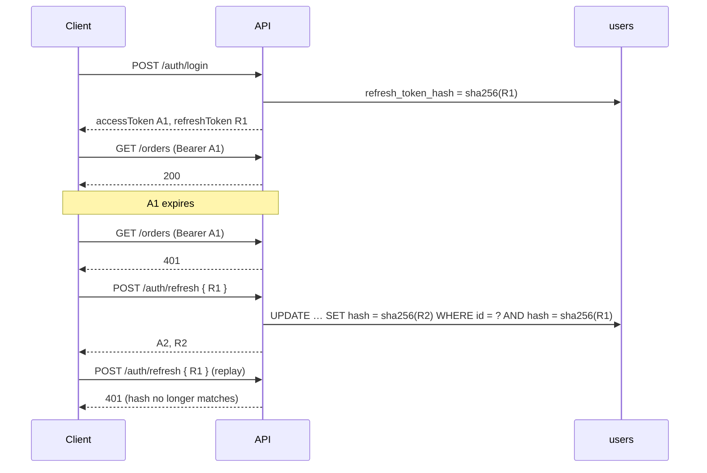

# JWT access + refresh tokens

Date: 2026-10-05

## Summary

Before, login returned a single JWT (`accessToken`, 7 days by default). The token could not be
revoked: logging out only deleted it in the browser, and changing your password left old tokens
working.

Now every login returns **two** tokens:

| Token | Lifetime (env) | Signed with | Used for | Stored on server |
|---|---|---|---|---|
| `accessToken` | `JWT_EXPIRES_IN` (default `7d`, recommended `15m`) | `JWT_SECRET` | `Authorization: Bearer …` on every API call and the chat socket | no (stateless) |
| `refreshToken` | `JWT_REFRESH_EXPIRES_IN` (default `30d`) | `JWT_REFRESH_SECRET` | getting a new pair from `POST /auth/refresh` | SHA-256 hash in `users.refresh_token_hash` |

> Since 2026-10-19 the middlewares named here are global guards (`JwtAuthGuard`, `RolesGuard`), and
> `PUBLIC_ROUTES` became `@Public()` decorators. See `AUTH_GUARDS.md`.

Authorization didn't change. `AuthMiddleware` still verifies the access token and reloads the user
on every request, so suspended or deleted accounts are rejected right away. `CheckRole(...)` and
`StoreAccessService` work as before.

## Database

Migration `backend/database/migrations/20261005000001-add-users-refresh-token.js`:

```sql
ALTER TABLE users ADD COLUMN refresh_token_hash VARCHAR(64) NULL;
```

- Holds the hex SHA-256 of the user's **current** refresh token. `NULL` means no refresh session:
  the user never logged in, logged out, or the session was revoked.
- The column stores a hash, not the token, so a leaked row can't be replayed as a token.
- Model: `User.refreshTokenHash` (`src/database/models/user.model.ts`). Like `passwordHash`, the
  default scope leaves it out, so it never appears in API responses.
- Rollback: `npm run db:migrate:undo` drops the column.

The migration runs on its own when the backend container starts (`npm run start:prod`), or
locally with `npm run db:migrate`.

## API changes

Every endpoint that logs a user in (`register`, `login`, `google`, `facebook`, `reset-password`)
now returns the same shape with one new field:

```json
{ "accessToken": "eyJ…", "refreshToken": "eyJ…", "user": { "id": 1, "username": "admin", … } }
```

New public endpoints (added to `PUBLIC_ROUTES` in `app.module.ts`):

| Method | Path | Body | Result |
|---|---|---|---|
| POST | `/api/auth/refresh` | `{ refreshToken }` | 200 with a new `{ accessToken, refreshToken, user }`. The old refresh token stops working (rotation). 401 if the token is invalid, expired, already used or revoked. 403 if the account is not active. 400 if `refreshToken` is missing. |
| POST | `/api/auth/logout` | `{ refreshToken }` | Always 200 `{ "message": "Logged out" }`. Clears the refresh session if this is the current token. Expired tokens are accepted, so logout works after the access token has expired. |

Changed endpoint:

| Method | Path | Change |
|---|---|---|
| PATCH | `/api/me/password` | Now returns `{ message, accessToken, refreshToken }`. The new pair replaces the stored refresh token, so other devices are signed out at their next refresh. The current device stays signed in if it saves the new tokens. |

## Behaviour



- **Rotation, single use.** `/auth/refresh` swaps the hash with one conditional `UPDATE`. A refresh
  token works once. If two requests race with the same token, only one wins.
- **One refresh session per user.** The column holds one hash, so logging in on a new device
  replaces the previous device's refresh token. The previous device keeps working until its access
  token expires, then must log in again. Supporting several devices at once would need a
  `refresh_tokens` table (one row per session) instead of a column.
- **Revocation** clears or replaces the hash in these cases:
  - `POST /auth/logout`: cleared.
  - `PATCH /me/password` or `POST /auth/reset-password`: replaced with a new token.
  - An admin sets the user's `status` to `inactive` or `suspended` (`PATCH /users/:id`): cleared.
    `/auth/refresh` also checks the status on every call.
- **Refresh tokens can't be used as access tokens.** They are signed with a different secret and
  carry `typ: "refresh"`, so `AuthMiddleware` and the chat gateway reject them (401).
- **Access tokens stay stateless.** An access token issued before a logout or password change works
  until it expires. That is why `JWT_EXPIRES_IN` should be short once the frontend refreshes.

## Configuration

New variables, added to `.env.example`, `backend/.env.example` and `docker-compose.yml`:

```env
JWT_REFRESH_SECRET=        # empty = derived from JWT_SECRET (still different from it)
JWT_REFRESH_EXPIRES_IN=30d
```

In production, set `JWT_REFRESH_SECRET` to its own long random value.

## Files changed

| File | Change |
|---|---|
| `backend/database/migrations/20261005000001-add-users-refresh-token.js` | new: adds `users.refresh_token_hash` |
| `backend/src/database/models/user.model.ts` | `refreshTokenHash` column, excluded from the default scope |
| `backend/src/common/types/auth-user.ts` | `RefreshPayload` type |
| `backend/src/modules/auth/token.service.ts` | new: `issue`, `rotate`, `revokeToken`, `revokeUser` |
| `backend/src/modules/auth/auth.service.ts` | `issueToken` uses `TokenService`; new `refresh`, `logout` |
| `backend/src/modules/auth/auth.controller.ts` | `POST auth/refresh`, `POST auth/logout` |
| `backend/src/modules/auth/dto/auth.dto.ts` | `RefreshTokenDto` |
| `backend/src/modules/auth/auth.module.ts` | provides and exports `TokenService` |
| `backend/src/modules/users/users.module.ts`, `users.service.ts` | password change issues a new pair; deactivating a user revokes the refresh session |
| `backend/src/app.module.ts` | `auth/refresh`, `auth/logout` in `PUBLIC_ROUTES` |
| `.env.example`, `backend/.env.example`, `docker-compose.yml` | `JWT_REFRESH_SECRET`, `JWT_REFRESH_EXPIRES_IN` |
| `README.md` | endpoint table rows |

## Verification

- `npm run build` passes, and the migration ran in the backend container.
- Manual checks: login returns both tokens and the hash is not in `user`. A refresh token sent as
  a Bearer token gets 401. Refresh rotates the token, and replaying the old one gets 401. A garbage
  token gets 401 and a missing body gets 400. Refresh after logout gets 401, and the column is
  `NULL`. The old refresh token gets 401 after a password change. Refresh gets 403 after an admin
  suspends the account.
- Postman regression suite: 186/186 requests, 242/242 assertions pass.

## Follow-up: frontend

The frontend doesn't use the refresh token yet. `frontend/src/redux/api/axiosClient.ts` still
logs the user out on any 401. That's why `JWT_EXPIRES_IN` stays at `7d` for now. To finish:

1. Save `refreshToken` next to `accessToken` after login, register, social login, reset-password
   and change-password.
2. In the 401 interceptor, call `POST /auth/refresh` once, with a single in-flight promise shared
   by concurrent requests. Then save the new pair and retry the request. Log out only if the
   refresh fails.
3. On logout, call `POST /auth/logout` with the refresh token.
4. Reconnect the chat socket (`lib/chatSocket.ts`) with the new access token after a refresh.
5. Then lower `JWT_EXPIRES_IN` to `15m`.
