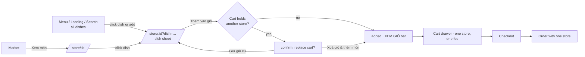

# One store per cart (GrabFood / ShopeeFood model)

Date: 2026-10-01

## What changed for shoppers

Before, one cart (and one order) could mix dishes from several stores. The order was split into one
`store_orders` row per store, with one delivery fee per store. Dishes could be added to the cart from
anywhere: the menu, the landing page or the search panel.

Now the app works like GrabFood and ShopeeFood:

1. **Discovery.** `/menu`, the landing page and the search panel still list every dish from every
   store.
2. **Ordering happens on the store page.** Clicking a dish (photo, name or "Thêm vào giỏ") opens
   the new store page, `/store/:storeId?dish=:productId`, with that dish's sheet already open. The
   sheet is where you pick options and quantity and add the dish to the cart. The store page also
   shows the store's details, its full menu grouped by category, and a "XEM GIỎ" bar when the cart
   holds this store's dishes.
3. **A cart holds one store's dishes.** Adding a dish from another store asks first:

   > **Đặt món từ quán khác?** Giỏ hàng đang có món của *Quán A*. Mỗi đơn chỉ đặt từ một quán,
   > thêm món của *Quán B* sẽ xoá giỏ hiện tại. [Giữ giỏ cũ] [Xoá giỏ & thêm món]

   The server enforces the same rule, so a stale tab or a direct API call can't mix stores.
4. **An order comes from one store**, with one delivery fee.

## Backend

| File | Change |
|---|---|
| [cart/dto/cart.dto.ts](../backend/src/modules/cart/dto/cart.dto.ts) | `AddCartItemDto.replaceCart?: boolean`. |
| [cart/cart.service.ts](../backend/src/modules/cart/cart.service.ts) | `addItem` runs in one transaction and locks the cart row (`SELECT … FOR UPDATE`), so two tabs can't mix stores. If the cart holds another store's dishes it answers **409** `{ code: "CART_STORE_CONFLICT", message, cartStore: { id, name } }`, or with `replaceCart: true` it empties the cart and then adds. `GET /cart` (and every cart mutation) now also returns `store`: the cart's store, or `null` when the cart is empty. |
| [orders/orders.service.ts](../backend/src/modules/orders/orders.service.ts) | Checkout rejects items from more than one store with **400** "An order can only contain dishes from one store". The check runs before stock is reserved. It covers both an explicit `items` list and checkout of the whole cart. |
| [orders/dto/order.dto.ts](../backend/src/modules/orders/dto/order.dto.ts) | Doc comment only. |
| [migrations/20261001000001-single-store-cart.js](../backend/database/migrations/20261001000001-single-store-cart.js) | **Data migration.** A cart that mixes stores keeps the store of its most recently added line. The other stores' lines are deleted (their `cart_item_options` rows go with them by cascade). `down` is a no-op. |

### What was *not* changed, and why
- **Orders and products were not cleared**, and the order schema is the same. You allowed wiping
  them, but it wasn't needed. New orders always have exactly one `store_orders` row. Existing
  multi-store orders stay valid: `OrderLifecycleService`, the store dashboard and the admin console
  handle any number of store orders. Keeping `store_orders` also means the store dashboard needed no
  changes.
- **Other tables are untouched.** The only data the migration changes is mixed-store cart lines.
- The rule is enforced in the service, not with a DB constraint. Postgres can't express "all
  `cart_items` of a cart belong to one store" without a trigger or a denormalised `carts.store_id`.
  The row lock gives the same guarantee for every write path, and `addItem` is the only path that
  can add a line.

## Frontend

| File | Change |
|---|---|
| [pages/StorePage/](../frontend/src/pages/StorePage/index.tsx) **(new)** | Store page `/store/:id`: cover, name, categories, rating, address (with a link to the map), save/chat buttons, the menu grouped by category with jump chips, a "XEM GIỎ · N món · total" bar (only when the cart is this store's), and a notice when the cart holds another store's dishes. |
| [pages/StorePage/DishSheet.tsx](../frontend/src/pages/StorePage/DishSheet.tsx) **(new)** | Modal opened by `?dish=`: photo, price, description, options, quantity, "Thêm vào giỏ", and a link to `/product/:id` for details and reviews. It closes once the dish is added. |
| [components/DishOptions/](../frontend/src/components/DishOptions/index.tsx) **(new)** | `useDishOptions()` and `<DishOptions>`: option selection moved out of `ProductDetailPage` so the sheet and the product page share it. |
| [hooks/useShop.ts](../frontend/src/hooks/useShop.ts) | New `useCartSwitch()`, the "replace cart?" confirm. `useAddToCart()` asks before adding to a cart that holds another store's dishes, also handles the server's 409 (for example when the cart changed in another tab), and now resolves to `true` once the dish is added. |
| [lib/format.ts](../frontend/src/lib/format.ts) | `storeHref(storeId, dishId?)` and `dishHref(product)`. |
| [components/DishCard](../frontend/src/components/DishCard/index.tsx) | Photo, name and "Thêm vào giỏ" all go to `dishHref`. The store name links to the store page. On the store page itself these links replace the history entry, so Back leaves the store instead of reopening the sheet. |
| [pages/LandingPage](../frontend/src/pages/LandingPage/index.tsx), [components/SearchPanel](../frontend/src/components/SearchPanel/index.tsx) | The quick "Thêm vào giỏ" / "+" buttons go to the dish's store page instead of adding directly. A search-result store's "XEM" opens its store page. |
| [pages/MarketPage](../frontend/src/pages/MarketPage/index.tsx) | "Xem món →" opens the store page. |
| [pages/MenuPage](../frontend/src/pages/MenuPage/index.tsx) | Always lists every dish. Old `/menu?store=N` links redirect to `/store/N`. |
| [pages/ProductDetailPage](../frontend/src/pages/ProductDetailPage/index.tsx) | Uses `DishOptions`. The breadcrumb, store link and "Xem tất cả" point at the store page. Adding from here goes through the same store check. |
| [components/CartDrawer](../frontend/src/components/CartDrawer/index.tsx) | Header note "Đặt từ *store* · phí giao …" with a link to the store, one delivery fee, and "+ Thêm món của *store*" to go back to the store page. |
| [pages/CheckoutPage](../frontend/src/pages/CheckoutPage/index.tsx) | Summary titled with the store name and one delivery fee. |
| [pages/AccountPage](../frontend/src/pages/AccountPage/index.tsx) | "Đặt lại" asks before replacing another store's cart, empties the cart if needed, adds items one at a time, then opens the cart. It's hidden for old multi-store orders. |
| [redux/api](../frontend/src/redux/api) | `useStoreQuery(id)` (`GET /stores/:id`), `useClearCartMutation()` (`DELETE /cart`), `addToCart` accepts `replaceCart`. Types: `Cart.store`, `StoreDetail`. |
| [App.tsx](../frontend/src/App.tsx) | Route `store/:id`. |

## Tests and docs

- **Postman** ([FoodMarketplace.postman_collection.json](../postman/FoodMarketplace.postman_collection.json)), now 186 requests:
  - *08 Cart*, after "Remove cart item": create, approve and stock a second store; add a store-1
    dish (`cart.store` = store 1); add a store-2 dish → 409 `CART_STORE_CONFLICT` naming store 1;
    add it with `replaceCart: true` → cart holds only the store-2 dish; `DELETE /cart` → 204. The
    cart is empty again before the existing "Re-add to cart", so the requests after it are
    unaffected.
  - *09 Orders*: "Checkout dishes from two stores -> 400".
- `README.md` (cart and checkout rows, checkout section) and `CLAUDE.md` (new "Shopping flow"
  section, checkout description, request count) are updated.

## Deploying

1. `docker compose up -d --build`. The backend container runs the new migration on start-up. For a
   local backend, run `npm run db:migrate`.
2. Run the suite:
   `cd postman && npx newman run FoodMarketplace.postman_collection.json -e local.postman_environment.json`.

## Verification status

- Backend `tsc --noEmit`: passes.
- Frontend `npm run build` (type-check + Vite build): passes.
- 2026-10-02, deployed with `docker compose up -d --build backend frontend`. The containers had been
  built before this change, so until then the running app still allowed mixed carts. The migration
  ran (`20261001000001-single-store-cart: migrated`), one mixed-store cart was trimmed, and no carts
  mix stores now.
- Newman, full suite: 186 requests, 242 assertions, 0 failures, including the 409
  `CART_STORE_CONFLICT`, `replaceCart` and "two stores → 400" tests.

## Effect on the issues in [USER_WORKFLOW.md](USER_WORKFLOW.md)

- **P6 (quick-add silently picks size S): fixed.** Every add now goes through the dish sheet or the
  product page, where options are visible.
- **P5 (login detour loses the item): improved.** A guest who adds from the sheet comes back after
  login to the store page with the same dish sheet open. They still press "Thêm vào giỏ" again, and
  their chosen options reset to the defaults.
- **P10 (multi-store tracking): no longer applies to new orders**, since each has one store.
- **P4 (fee is a client-side copy): smaller.** There is now one fee, but the browser still shows a
  build-time copy of it.
- P1, P2, P3, P7, P8, P9, P11, P12 and P13 are unchanged.
