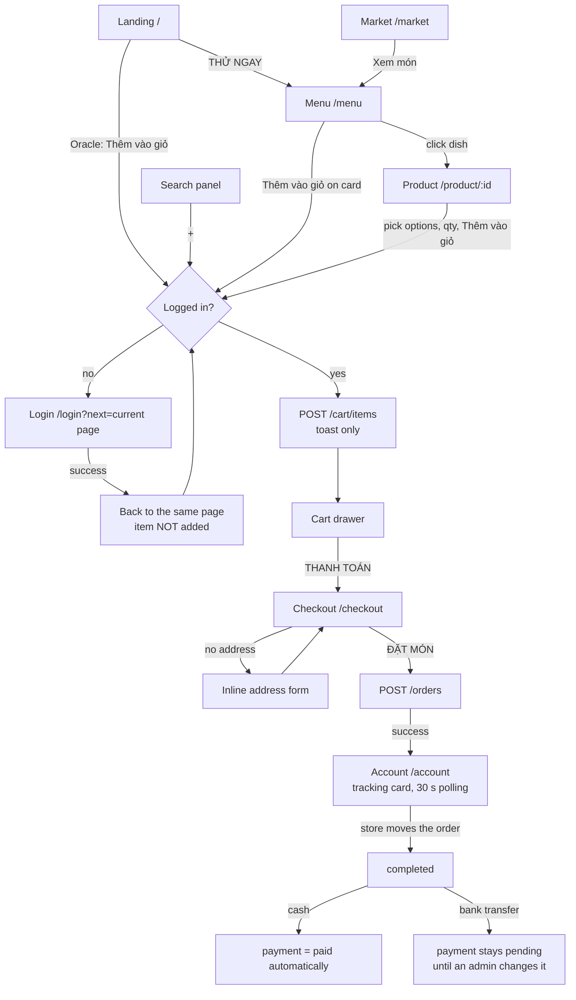

# Customer workflow: from landing to payment

This document traces what a shopper does on the storefront, from the first visit until the order is
paid, and lists where that flow breaks or confuses. It is based on a read of the frontend
(`frontend/src`) and the backend modules behind each step (`cart`, `orders`, `addresses`, `auth`).

> **Update 2026-10-01:** the cart and orders are now single-store, and dishes are ordered from a
> store page (GrabFood / ShopeeFood model). The flow in sections 1–2 describes the earlier
> multi-store version. See [SINGLE_STORE_CART.md](SINGLE_STORE_CART.md) for the new flow and for which
> problems below it fixes (P6), improves (P4, P5) or makes moot (P10).

Severity: **High** = money or orders go wrong; **Medium** = the user gets stuck, confused or misled;
**Low** = friction or polish.

---

## 1. The flow at a glance

## 2. Step by step

### 2.1 Arrival and browsing
| Step | Where | What happens |
|---|---|---|
| Landing | [LandingPage](../frontend/src/pages/LandingPage/index.tsx) | Hero with "THỬ NGAY" → `/menu`; 3 newest dishes; a random "oracle" dish with an add-to-cart button. |
| Menu | [MenuPage](../frontend/src/pages/MenuPage/index.tsx) | Products grouped by category, filters in the URL (`store`, `category`, `sort`, `q`). Fetches at most 100 products ([catalogApi.ts:21](../frontend/src/redux/api/catalogApi.ts#L21)). |
| Search | [SearchPanel](../frontend/src/components/SearchPanel/index.tsx) | Header overlay: 6 dishes + 5 stores, each dish has a quick "+" add. |
| Market | [MarketPage](../frontend/src/pages/MarketPage/index.tsx) | Store map and list; "Xem món" → `/menu?store=id`. |
| Product | [ProductDetailPage](../frontend/src/pages/ProductDetailPage/index.tsx) | Photos, options (size S/M by default), quantity stepper capped by stock, reviews, "more from this store". |

Guests can browse everything. There is no guest cart.

### 2.2 Add to cart
All add buttons go through `useAddToCart()` ([useShop.ts:27-43](../frontend/src/hooks/useShop.ts#L27-L43)):
1. If not logged in → toast + redirect to `/login?next=<current page>`.
2. Otherwise `POST /cart/items`. If no `optionIds` are sent, the server picks the first available
   option of every required group (size S) ([product-options.ts:19](../backend/src/modules/products/product-options.ts#L19)).
3. A toast says "Đã thêm … vào giỏ". The cart badge in the header updates. The drawer does not open.

Quick-add buttons (dish card, landing oracle, search "+") never send options. Only the product page
sends the user's choices.

### 2.3 Login / register
[LoginPage](../frontend/src/pages/LoginPage/index.tsx): login, register (with an "I'm a store
owner" checkbox), or social login. On success it sends the user to `next` (default `/account`).
Registration logs the user in immediately; there is no email verification step.

### 2.4 Cart
[CartDrawer](../frontend/src/components/CartDrawer/index.tsx) is opened from the header icon. The cart
is stored on the server, so it follows the account across devices.
- Each line shows options, store, a −/+ stepper and a delete button.
- `GET /cart` marks a line `available: false` when the product or store is inactive, an option is
  unavailable, **or the total quantity of that product in the cart exceeds stock**
  ([cart.service.ts:63-68](../backend/src/modules/cart/cart.service.ts#L63-L68)). Unavailable lines
  are greyed out with "Tạm hết, không tính tiền" and are left out of the subtotal.
- The delivery fee is estimated in the browser as `stores × VITE_DELIVERY_FEE_PER_STORE`
  ([format.ts:4](../frontend/src/lib/format.ts#L4)).
- "THANH TOÁN" → `/checkout`.

### 2.5 Checkout
[CheckoutPage](../frontend/src/pages/CheckoutPage/index.tsx):
1. Redirects to login if there is no session.
2. Address: radio list of saved addresses (default preselected). With none, the inline
   [AddressForm](../frontend/src/components/AddressPicker/AddressForm.tsx) opens (search, ward/province, map pin).
3. Payment: two choices, **"Tiền mặt khi nhận món"** (`cash`) and **"Chuyển khoản"** (`bank_transfer`).
4. Summary: available lines, subtotal from the cart, fee estimate, total.
5. "ĐẶT MÓN" sends `POST /orders` with the address, the method **and the item list copied from the
   cached cart** ([CheckoutPage:47-50](../frontend/src/pages/CheckoutPage/index.tsx#L47-L50)).

Server side ([orders.service.ts:74-180](../backend/src/modules/orders/orders.service.ts#L74-L180)), in
one transaction: re-price every line, reserve stock atomically, split into one `store_order` per
store, snapshot the address, create **one** `payments` row (status `pending`) and one `deliveries`
row, then remove the ordered products from the cart.

### 2.6 After placing the order
- Toast "Đặt hàng thành công! Đơn #DU-…", then redirect to `/account`
  ([CheckoutPage:51-52](../frontend/src/pages/CheckoutPage/index.tsx#L51-L52)).
- [AccountPage](../frontend/src/pages/AccountPage/index.tsx) shows one tracking card per active
  order, refreshed every 30 s: 4-step progress, items, fee, total, and "Huỷ đơn" while the order is
  `pending`/`confirmed`.
- Each store moves its own slice `pending → confirmed → preparing → ready → delivering → completed`
  from its dashboard. The parent order shows the **least advanced** store's status
  ([order-lifecycle.service.ts:76-79](../backend/src/modules/orders/order-lifecycle.service.ts#L76-L79)).

### 2.7 Payment
There is no payment step in the UI. Payment status changes only here:

| Event | Effect on the payment row ([order-lifecycle.service.ts:101-115](../backend/src/modules/orders/order-lifecycle.service.ts#L101-L115)) |
|---|---|
| Order reaches `completed`, method `cash` | `pending → paid` automatically |
| Order reaches `completed`, method `bank_transfer` | nothing; stays `pending` |
| Whole order cancelled | `pending → failed`, `paid → refunded` |
| Some stores cancelled | `amount` re-synced, **only while `pending`** |
| Admin console | `PATCH /payments/:id/status` (manual) |

---

## 3. Problems found

### P1 — "Chuyển khoản" (bank transfer) has no payment flow · **High**
The checkout offers bank transfer, but after the order is placed:
- The customer is never shown an account number, QR code, amount or transfer reference. Nothing in
  the frontend displays payment information to a customer (`Payment` is only used in the admin
  console).
- The customer never sees whether the order is paid. The tracking card shows order status only
  ([AccountPage:58-86](../frontend/src/pages/AccountPage/index.tsx#L58-L86)).
- The store does not see the payment method or status. Store-order queries do not include `Payment`
  ([store-orders.service.ts:72-83](../backend/src/modules/orders/store-orders.service.ts#L72-L83)),
  so a store can cook and deliver an unpaid transfer order, and the courier doesn't know whether to
  collect cash.
- Nothing ties payment to fulfilment. An admin can mark the payment `failed` and the order keeps
  going. A completed transfer order stays `pending` forever unless an admin edits it.

**Effect:** the customer picks a method that cannot actually be completed. This is the main break
between "place order" and "finish payment".

**Fix options:** (a) hide "Chuyển khoản" until it works; or (b) build it: show bank details/VietQR
with amount and `DU-<id>` reference after checkout and on the order card, add a "chờ thanh toán"
state the store can see, and let the store or a webhook (e.g. a VietQR / bank callback) confirm
payment. Show the payment method and status on the customer card and the store dashboard either way.

### P2 — Refunds are recorded but never happen · **High**
- Full cancellation of a `paid` order sets the payment to `refunded` automatically
  ([order-lifecycle.service.ts:103](../backend/src/modules/orders/order-lifecycle.service.ts#L103)).
  No money moves and nobody is told to refund.
- Partial cancellation (one store cancels) of a paid order reduces `orders.total`, but the payment's
  `amount` is only updated while `pending`, so the customer's over-payment is silently kept.

**Fix:** use a `refund_pending` state (or a task for admins) instead of jumping to `refunded`, and
record partial refunds when a store order is cancelled after payment.

### P3 — Checkout can create duplicate orders on a slow network · **High**
The client timeout is 15 s ([axiosClient.ts:15](../frontend/src/redux/api/axiosClient.ts#L15)). If
`POST /orders` succeeds on the server but the response arrives late, the user sees "Máy chủ phản hồi
quá lâu" and stays on the page. The cart cache is only invalidated on success, so the page still
shows the old cart. Clicking "ĐẶT MÓN" again sends the same **explicit `items` list**, which the
server accepts even though the cart was already emptied. Result: a second order and a second stock
reservation.

**Fix:** stop sending `items` from the client (the server already falls back to the cart, which is
empty after the first success), and/or add an idempotency key per checkout attempt. Refetch the cart
after any checkout error.

### P4 — The charged total can differ from the displayed total · **Medium**
The checkout summary uses the cached cart subtotal and a browser-side fee constant. The server
re-prices everything and uses its own `DELIVERY_FEE_PER_STORE`.
- If a sale ends or a price changes while the page is open, the user is charged the new amount
  without being told. The success toast shows only the order number.
- The fee is a build-time Vite variable ([format.ts:4](../frontend/src/lib/format.ts#L4)).
  `docker-compose.yml` passes `DELIVERY_FEE_PER_STORE` only to the backend, so changing it there
  makes every cart and checkout show the wrong fee.

**Fix:** have `GET /cart` (or a `POST /orders/preview`) return the fee and total from the server;
on checkout, compare the returned `order.total` with the displayed one and warn if they differ.

### P5 — Logging in throws away what the user was doing · **Medium**
A guest who presses "Thêm vào giỏ" is sent to `/login?next=…` and then back to the same page, but
the item is not added and, on the product page, the chosen options and quantity are reset. The user
has to do it all again, and many won't notice nothing was added.

**Fix:** save the pending add (product, options, qty) in `sessionStorage` or the `next` URL and
replay it after login; or support a guest cart that is merged on login.

### P6 — Quick-add silently picks size S · **Medium**
Dish cards, the landing oracle and the search "+" call `addProduct(p)` without options
([DishCard:41](../frontend/src/components/DishCard/index.tsx#L41),
[LandingPage:74](../frontend/src/pages/LandingPage/index.tsx#L74),
[SearchPanel:94](../frontend/src/components/SearchPanel/index.tsx#L94)). The server adds the default
(size S). The button shows the base price, and the user is never asked. For products with several
required groups, every choice is made for them.

**Fix:** if a product has any option group with more than one option, open a small options sheet
(or go to the product page) instead of adding directly. Mention the chosen size in the toast.

### P7 — "Đặt lại" (reorder) loses options · **Medium**
Reorder adds each item with `productId` and `quantity` only
([AccountPage:122](../frontend/src/pages/AccountPage/index.tsx#L122)), so a past size-M order comes
back as size S at a lower price. Order items store option *names* (snapshots), not option ids, so the
client cannot rebuild the choice.

**Fix:** keep `option_id` (nullable) on `order_item_options`, or match the snapshot names to current
options, and send `optionIds` on reorder.

### P8 — "Out of stock" message is wrong when only the quantity is too high · **Medium**
If the cart quantity of a product is above its stock (for example after someone else ordered), every
line of that product is marked unavailable and shows "Tạm hết, không tính tiền"
([CartDrawer:68](../frontend/src/components/CartDrawer/index.tsx#L68)). The product is not sold out.
The user just needs to lower the quantity, but nothing says so, and checkout quietly drops those
lines.

**Fix:** return a reason per line (`inactive`, `option_unavailable`, `exceeds_stock` with
`stock` remaining) and show "Chỉ còn N phần — giảm số lượng" with a one-tap fix. List dropped lines
on the checkout page.

### P9 — No order confirmation page · **Medium**
After checkout the user lands on the account page with a toast that disappears in a few seconds.
There is no screen that confirms the order number, total, payment method, what to do next (pay by
transfer, have cash ready) or the delivery address.

**Fix:** add `/orders/:id` (also reachable from history) as the confirmation and tracking page.

### P10 — Tracking is thin for multi-store orders · **Medium**
- The card merges all stores' items into one list and shows one status: the slowest store's
  ([AccountPage:46](../frontend/src/pages/AccountPage/index.tsx#L46)). If store A has delivered and
  store B is still pending, the customer sees "Chờ quán xác nhận" for everything.
- Cancel is all-or-nothing and only while every store is `pending`/`confirmed`
  ([orders.service.ts:241](../backend/src/modules/orders/orders.service.ts#L241)). The customer
  can't drop just the slow store.
- Updates arrive by 30 s polling only, and only while the account page is open. The Socket.IO
  connection used for chat is not used for order events.
- "dự kiến HH:MM" never appears: `deliveries.estimated_at` can only be set through
  `PATCH /deliveries/:id`, and no screen sends it.

**Fix:** group the card by store with a per-store status; allow cancelling a single store order while
it is `pending`; push order status changes over the existing socket; let stores set an ETA when
confirming.

### P11 — Orders can sit in `pending` forever · **Medium**
Stores have no opening hours and orders have no confirmation timeout. A customer can order from a
store that is closed or inactive in practice, and nothing cancels or escalates the order if the store
never confirms. The customer's only option is to cancel manually.

**Fix:** add opening hours (block checkout when closed) and a job that auto-cancels (restoring stock)
store orders not confirmed within N minutes, with a notice to the customer.

### P12 — Server error messages are in English · **Medium**
The UI is Vietnamese, but `errorMessage()` shows the API's text as-is
([baseApi.ts:17-28](../frontend/src/redux/api/baseApi.ts#L17-L28)). At the most important moments
the user reads English: `Not enough stock for "Cơm tấm"`, `Only 3 "…" left in stock`,
`"…" - "Kích cỡ" requires 1-1 selection(s)`, `Order can no longer be cancelled`.

**Fix:** return a stable `code` with errors (e.g. `OUT_OF_STOCK`, `{ name, stock }`) and map codes to
Vietnamese text in the frontend.

### P13 — Smaller friction · **Low**
- Adding to cart only shows a toast. There is no "Xem giỏ" action and the drawer doesn't open, so
  first-time users may not find the cart.
- The menu loads at most 100 dishes with no pagination; beyond that, dishes are reachable only through
  filters or search ([MenuPage:88-90](../frontend/src/pages/MenuPage/index.tsx#L88-L90)).
- The admin can change the delivery status independently of the store-order status
  ([AdminPage/OrdersView.tsx:54](../frontend/src/pages/AdminPage/OrdersView.tsx#L54)), so the
  delivery can say "delivered" while the order says "ready".
- There is no delivery-area check: a customer can order from a store on the other side of the city
  for the same flat fee.
- The checkout radio label "Chuyển khoản" gives no hint of what happens next (ties into P1).
- After checkout, products are removed from the cart **by product id**, so an unavailable line of the
  same product (e.g. a size whose option was disabled) is deleted too
  ([orders.service.ts:170-175](../backend/src/modules/orders/orders.service.ts#L170-L175)).

---

## 4. Summary table

| # | Problem | Stage | Severity |
|---|---|---|---|
| P1 | Bank transfer has no instructions, status or confirmation | Payment | High |
| P2 | Refunds marked done but never executed; partial cancels not refunded | Payment | High |
| P3 | Retry after a timeout can create a duplicate order | Checkout | High |
| P4 | Charged total can differ from displayed total; fee is a build-time copy | Cart / Checkout | Medium |
| P5 | Login detour loses the item and chosen options | Add to cart | Medium |
| P6 | Quick-add silently chooses size S | Add to cart | Medium |
| P7 | Reorder loses options | After order | Medium |
| P8 | "Tạm hết" shown when only the quantity is too high | Cart | Medium |
| P9 | No order confirmation page | After order | Medium |
| P10 | Multi-store tracking merged; all-or-nothing cancel; no push; no ETA | Tracking | Medium |
| P11 | No opening hours, no confirmation timeout | Checkout / Tracking | Medium |
| P12 | English error messages in a Vietnamese UI | All | Medium |
| P13 | Small friction items | Various | Low |

## 5. Suggested order of work

1. **P3** (small change: drop `items` from the checkout body, refetch the cart on error).
2. **P1**, first step: hide "Chuyển khoản" or show bank details + reference; show payment method and
   status to the customer and the store. Then the full confirmation flow.
3. **P9 + P10**: one `/orders/:id` page for confirmation and per-store tracking.
4. **P4, P8, P12**: make the server the single source of truth for totals, line problems and
   messages.
5. **P5, P6, P7**: keep the user's choices (after login, on quick-add, on reorder).
6. **P2, P11**: refund handling and timeouts; these need product decisions first.
